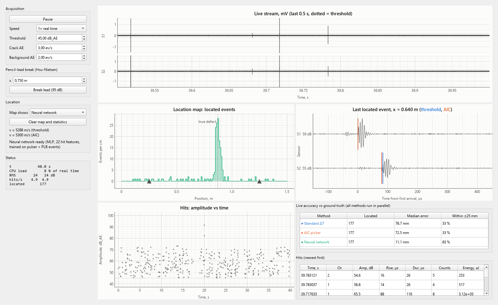
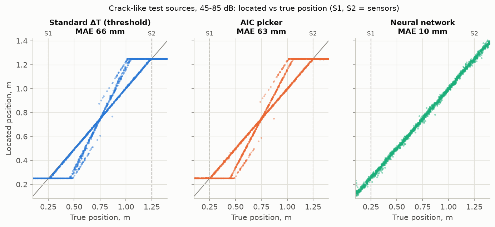
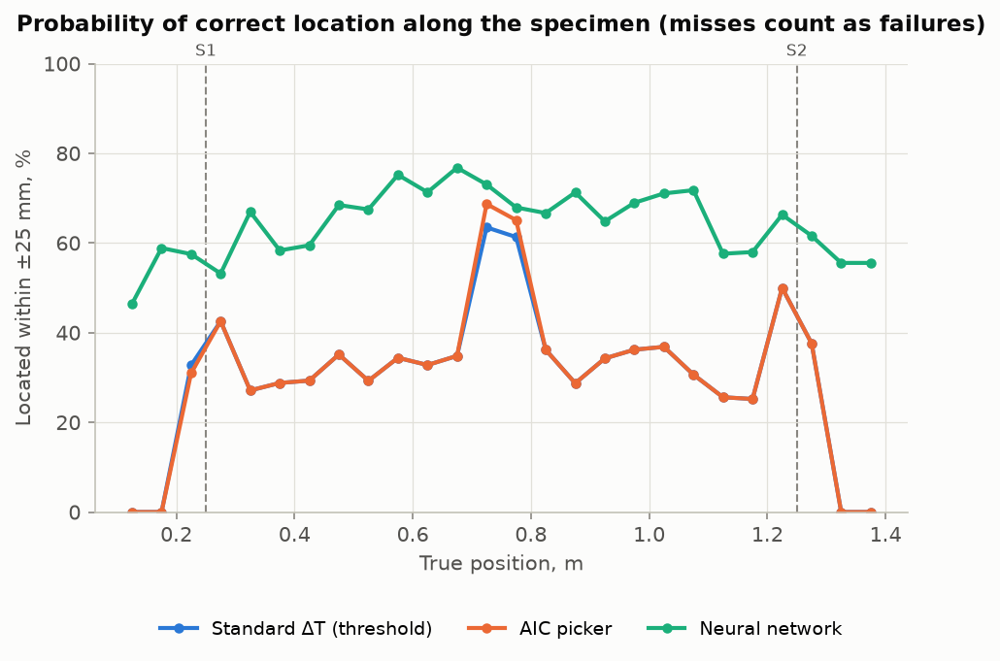
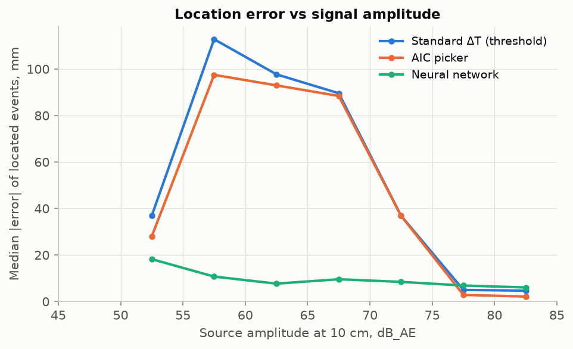
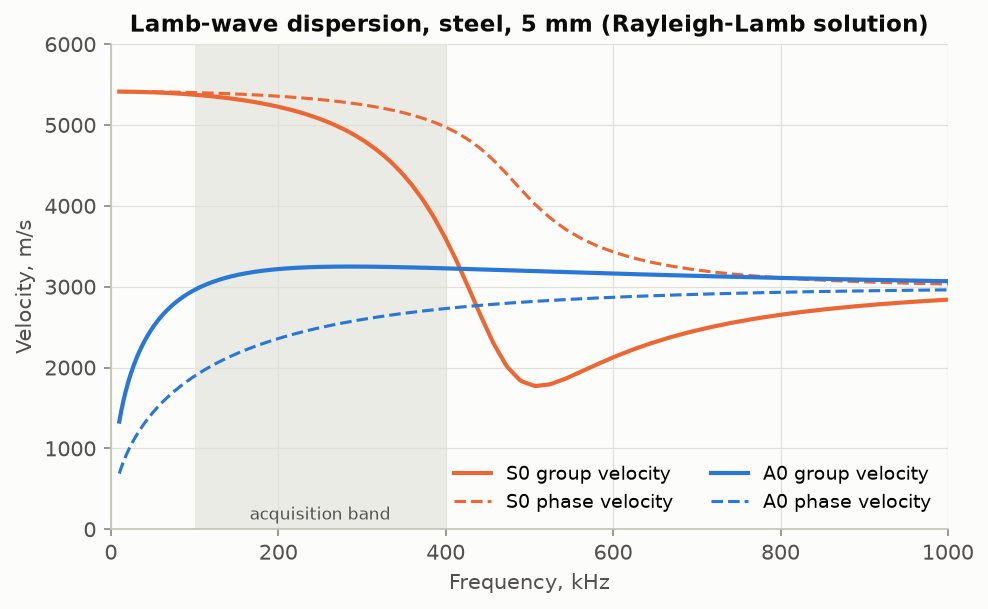
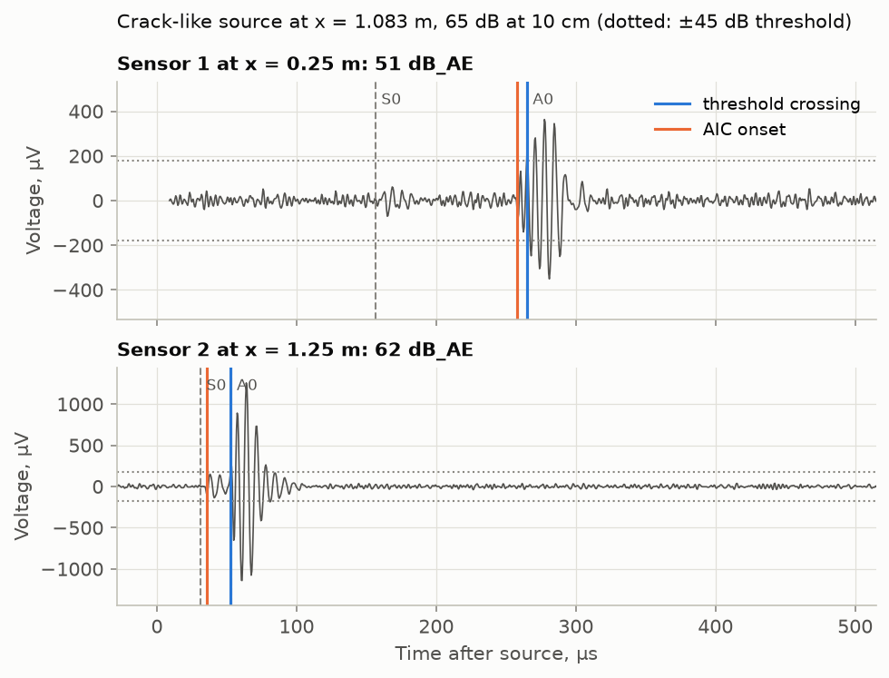
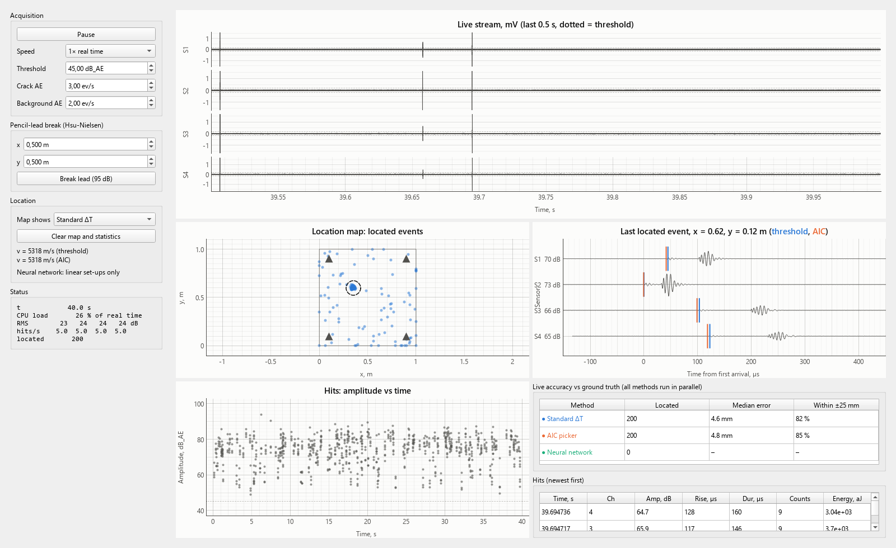
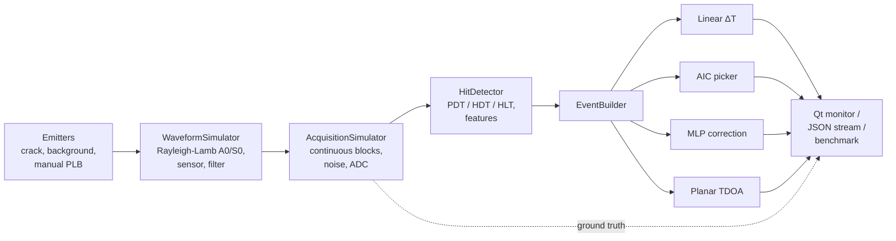

# aelocate: acoustic emission source location workbench

[](https://github.com/Linklow/aelocate/actions/workflows/ci.yml)


A physics-based **acoustic emission (AE) acquisition simulator**, a **streaming hit detector**
with standard PDT/HDT/HLT timing, **linear and planar source location**, a **neural-network
location correction**, and a **real-time Qt monitor**. The whole processing chain of an AE
instrument runs in software, from the elastic wave in the plate to the located event on screen,
and every stage is checked against ground truth.



*A crack (dashed line) emits AE in a 1 m sensor base on a 5 mm steel plate, with background
events everywhere else. All three location methods run in parallel and are scored live against
the true source positions: median error 11 mm for the neural network, 79 mm for the standard
ΔT algorithm.*

## Why

Linear location by time difference (ΔT) is the workhorse of AE testing for pressure vessels,
pipelines, welds and rails. It assumes one wave speed and one clean arrival. On a plate the
threshold crossing picks the fast **S0** Lamb mode for strong or nearby signals and the slow,
dispersive **A0** mode for weak or distant ones. One sensor can trigger on S0 while the other
triggers on A0, and the crossing slides later in the rise as amplitude drops. The located
position then picks up an *additive* and a *multiplicative* error that depend on amplitude and
position. This was the subject of my research at the Russian Academy of Sciences (see
[Background](#background)). This repository turns that work into tested, reusable software.

## Results

Benchmark protocol (`aelocate benchmark`, [`benchmark.py`](src/aelocate/benchmark.py)), in the
same order as practice on a real structure:

1. **Velocity calibration** with ~95 dB Hsu-Nielsen pencil-lead breaks at marked points.
2. **Training** (NN only): pulser location pulses and pencil-lead breaks at known positions.
3. **Test:** 3000 *crack-like* sources (0.6 µs rise time, never seen in calibration or training),
   45-85 dB, anywhere within 15 cm of the sensor base.

| Method | Located | MAE | Median | P90 | Located within ±25 mm* |
|---|---:|---:|---:|---:|---:|
| Standard ΔT (threshold crossing) | 68.2% | 65.6 mm | 41.7 mm | 174.8 mm | 30.5% |
| AIC onset picker | 68.2% | 62.8 mm | 40.0 mm | 166.9 mm | 30.8% |
| **Neural network (MLP, 22 hit features)** | 68.2% | **10.2 mm** | **7.9 mm** | **21.2 mm** | **64.1%** |
| Neural network, pulser-only training (ablation) | 68.2% | 45.9 mm | 36.5 mm | 97.8 mm | 24.9% |

\* Share of *all* generated events, so missed and unlocated events count as failures. About 32%
of the weakest sources never reach the far sensor above threshold, and no method can locate
those.



What the benchmark shows:

* **The standard algorithm has two branches.** Events caught on S0 at both sensors fall on the
  diagonal. Events caught on A0 fall on a line of slope about *v*<sub>S0</sub>/*v*<sub>A0</sub> ≈ 1.7:
  the multiplicative error. Sources near or behind a sensor pile up *at* the sensor.
* **A better picker is not enough.** AIC removes part of the timing bias, but it cannot fix a
  mode mismatch between the two sensors.
* **The network removes most of the error and makes it amplitude-independent.** MAE drops
  6.4x and P90 8x.
* **Training data must span source mechanisms.** Trained on pulser bursts alone, the network
  transfers poorly to step-like crack sources (MAE 46 mm, a domain shift). Adding pencil-lead
  breaks to the training set fixes this.

| Probability of correct location along the plate | Error vs signal amplitude |
|---|---|
|  |  |

Full per-zone tables (near sensor, mid-span, outside base): [`docs/figures/results.md`](docs/figures/results.md).

> All numbers come from simulation. The model is deliberately physical (next section), but
> validating against experimental data is the next step (see the [roadmap](#roadmap)).

## Physics model

| Stage | Model |
|---|---|
| Wave propagation | **Rayleigh-Lamb equations solved numerically** for the A0 and S0 modes ([`dispersion.py`](src/aelocate/dispersion.py)). Synthesis in the frequency domain, so dispersion, mode separation and pulse spreading come out of the physics. Frequency-dependent attenuation, geometric spreading, optional end reflections (image sources). |
| Sources | Hsu-Nielsen pencil-lead break (1.5 µs step), crack advance (0.6 µs step), pulser (3-cycle 150 kHz burst). Amplitude is set as dB<sub>AE</sub> at 10 cm. |
| Sensor | 150 kHz resonant (Q = 5) or wideband 100 kHz-1 MHz. |
| Front-end | 40 dB preamplifier, 100-400 kHz Butterworth band-pass, 16-bit ±10 V ADC (clips at 100 dB<sub>AE</sub>, like real hardware), band-limited background noise, 2 MHz sampling. |

The solver is tested against the analytic limits: S0 approaches the plate velocity and A0 the
Kirchhoff flexural velocity at low frequency, and both approach the Rayleigh velocity at high
frequency.

| Dispersion curves, 5 mm steel | One simulated event: threshold vs AIC picks |
|---|---|
|  |  |

In the example event, S0 arrives first on both sensors but stays below the 45 dB threshold.
Both threshold crossings land on A0, so the ΔT is computed with the wrong velocity.

## Hit detection and processing

* **Hit definition per ASTM E1316 / AEwin conventions:** threshold in dB<sub>AE</sub>, PDT, HDT,
  HLT, max duration. Features: arrival time (sub-sample interpolated), peak amplitude, rise
  time, duration, counts, counts-to-peak, absolute energy (aJ) and the transient waveform with
  pre-trigger.
* **Streaming and block-size invariant.** The detector keeps its state between blocks, and the
  tests check that splitting a record into blocks of 1, 7, 333, ... samples gives identical
  hits ([`test_hits.py`](tests/test_hits.py)).
* **Vectorised per threshold excursion**, not per sample: about 35 MS/s on a laptop in pure
  NumPy, roughly 9x real time for 2 channels at 2 MHz (`aelocate stream`).
* **Event builder** with an event-definition window and latency handling, because hits finish
  out of order across channels.
* **Locators:** linear ΔT (any number of sensors in a line, adjacent-zone logic, clamping),
  planar TDOA least squares, AIC onset picker (Maeda), MLP correction ([`ml.py`](src/aelocate/ml.py)),
  and velocity calibration from known-position sources.

## Real-time monitor

`aelocate gui` (PySide6 + pyqtgraph):

* live multichannel stream with threshold, location map, last located event with threshold
  and AIC picks, amplitude-vs-time hit plot, hit table;
* **all location methods run in parallel and are scored live against the simulator's ground
  truth**;
* controls for threshold, source rates, playback speed, and a "break lead" button that injects
  a Hsu-Nielsen source anywhere on the specimen;
* acquisition and processing run in a worker thread. Settings changes are queued and applied
  between blocks, so the UI never blocks acquisition and the processing state has a single owner.



*Planar TDOA location with four sensors (dashed circle = true defect). With strong signals
S0 triggers every sensor and the median error is about 5 mm. Weak signals bring back the mode
mismatch, so ML for planar location is on the roadmap.*

## Architecture



| Module | Responsibility |
|---|---|
| `dispersion`, `materials` | Lamb-wave dispersion solver, material constants |
| `sources`, `instrument`, `specimen`, `simulator` | Physics-based waveform synthesis |
| `daq` | Continuous multichannel stream, noise, ADC, ground truth |
| `hits`, `pickers`, `events` | Streaming hit detection, AIC picking, event building |
| `location`, `ml` | Linear / planar location, velocity calibration, NN locator |
| `pipeline`, `presets`, `scenarios` | Processing chain and ready-made set-ups |
| `benchmark`, `plots` | Accuracy protocol and report figures |
| `gui` | Real-time monitor (worker thread + PySide6/pyqtgraph UI) |

## Quick start

```bash
git clone https://github.com/Linklow/aelocate.git
cd aelocate
python -m venv .venv
source .venv/bin/activate        # Windows: .venv\Scripts\activate
pip install -e ".[all]"

aelocate gui                                  # real-time monitor (linear location)
aelocate gui --preset plate-planar            # planar location, 4 sensors
aelocate benchmark --out docs/figures         # reproduce the results above (~30 s)
aelocate stream --seconds 10                  # headless: located events as JSON lines
pytest                                        # 33 tests
```

Python API:

```python
import aelocate as ae

setup = ae.steel_plate_linear()                        # 5 mm steel, sensors at 0.25 m and 1.25 m
daq = ae.AcquisitionSimulator(setup.simulator, block_size=40_000, seed=1)
chain = ae.ProcessingChain.from_setup(setup, setup.locator(velocity=5300))

daq.inject(ae.PLB, position=[0.62], amplitude_db=95)   # Hsu-Nielsen source at x = 0.62 m
for _ in range(10):                                    # 10 blocks x 20 ms
    out = chain.process(daq.next_block())
    for hit in out.hits:
        print(f"ch{hit.channel}  {hit.amplitude_db:.1f} dB  rise {hit.rise_time*1e6:.0f} us")
    for ev in out.located:
        print(f"located x = {ev.x:.3f} m")
```

## Roadmap

- [ ] Hardware abstraction: a `DataSource` interface so a real DAQ board or a recorded file
      can replace the simulator; import of common AE waveform formats.
- [ ] C++ hit-detection core with pybind11 bindings (embedded-class throughput, same tests).
- [ ] MQTT telemetry of located events for remote monitoring (IIoT).
- [ ] Cluster analysis and zonal location; ML for planar location; anisotropic composites
      (direction-dependent velocity).
- [ ] Validation on public experimental datasets (Hsu-Nielsen breaks on plates and concrete).

## Background

Author: **Ivan Mishchenko**. M.S. in Computer Science and Engineering (thesis: *Application of
artificial neural networks to improve the accuracy of linear location of acoustic emission
sources*),
B.S. in Instrument Engineering (thesis: *Development of a method for improving the accuracy
of linear location of acoustic emission sources*), 3 years of NDT research at the Russian Academy of Sciences, now a
software engineer. [Google Scholar](https://scholar.google.com/citations?user=AiYf5nwAAAAJ&hl=en).

Related publications:

* Marchenkov A., Vasiliev I., Chernov D., ..., Mishchenko I. *Estimation of Acoustic Source
  Positioning Error Determined by One-Dimensional Linear Location Technique.* Applied Sciences
  12(1), 224, 2022. [doi:10.3390/app12010224](https://doi.org/10.3390/app12010224)
* Matvienko Yu. G., Vasil'ev I. E., Chernov D. V., Kozhevnikov A. V., Mishchenko I. V.
  *Increasing Probability of Detecting Acoustic Emission Sources Using Artificial Neural
  Networks.* Russian Journal of Nondestructive Testing 58(5), 333-341, 2022.
  [doi:10.1134/S1061830922050059](https://doi.org/10.1134/S1061830922050059)
* Matvienko Yu. G., Ivanov V. I., Vasil'ev I. E., Chernov D. V., Mishchenko I. V. *Error
  Reduction in Determining the Wave-Packet Speed in Composite Materials.* Instruments and
  Experimental Techniques 63(1), 106-111, 2020.
* Makhutov N. A., Vasil'ev I. E., Chernov D. V., Mishchenko I. V., et al. *Estimation of the
  additive and multiplicative error of the standard algorithm of acoustic emission sources
  linear location.* IOP Conf. Series: Materials Science and Engineering 1129, 2021.

Method references: Maeda N. (1985), AIC onset picking; Kurz J. H. et al. (2005), AIC for AE
onset detection; ASTM E1316 (AE terminology); Rose J. L., *Ultrasonic Guided Waves in Solid
Media* (Lamb-wave dispersion).

## License

MIT
